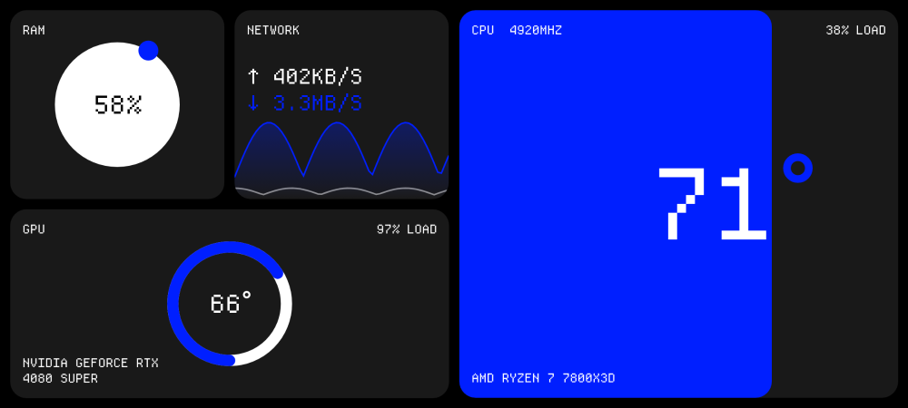
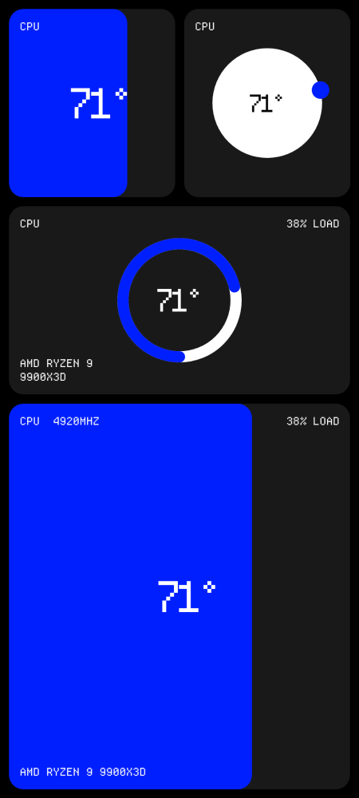
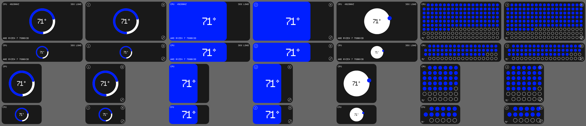
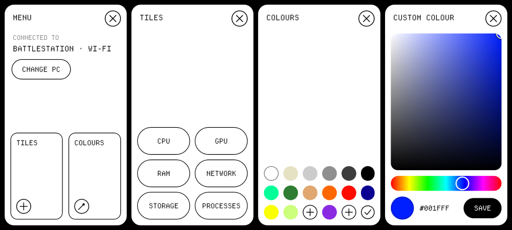

# Myty Monitor

Live PC stats (CPU and GPU temperatures, load, clocks, fans, RAM, network, storage, top processes) shown fullscreen on your phone in the Myty bento style.



Portrait keeps the same layout, with the right half below the left:



It has two parts:

| Folder | What it is |
| --- | --- |
| `windows/` | **Myty Monitor for Windows**. A small tray app that reads the PC's sensors every second and serves them on port 5317. |
| `android/` | **Myty Monitor for Android**. A fullscreen dashboard that connects to the PC over Wi-Fi or a USB cable. |

## Getting the apps

Every push runs **GitHub Actions → Build apps**, which uploads two downloads:

- `MytyMonitor-windows` contains `MytyMonitor.exe` (a single file; .NET doesn't need to be installed)
- `MytyMonitor-android` contains `app-release.apk`

To build them yourself:

```powershell
# Windows app (needs the .NET 8 SDK)
dotnet publish windows/MytyMonitor/MytyMonitor.csproj -c Release -o out
```

```bash
# Android app (needs JDK 17 and the Android SDK, or just open android/ in Android Studio)
cd android && ./gradlew assembleRelease
# -> android/app/build/outputs/apk/release/app-release.apk
```

## Using it

1. **On the PC**, run `MytyMonitor.exe`. It asks for admin rights, because Windows only lets admin programs read CPU temperatures and fan speeds. The window shows the PC's address and whether a phone is connected. Closing the window keeps it running in the tray; right-click the tray icon to exit. Tick **Start with Windows** to launch it at login with no UAC prompt.
2. **On the phone**, open Myty Monitor and tap your PC. It reconnects to the same PC automatically next time.

### Wi-Fi

Put the phone and PC on the same network. The PC announces itself over UDP port 5318, so it shows up in the app's list. If it doesn't (some routers block this, for example guest networks or "AP isolation"), type the address shown in the PC window, such as `192.168.1.20`.

The first time it runs, the PC app opens TCP port 5317 (stats) and UDP port 5318 (discovery) in Windows Firewall. Other antivirus or firewall software may need the same two ports allowed.

**Can't connect?** In the phone's browser, open `http://<PC address>:5317` (for example `http://192.168.1.20:5317`).
- If the page says *"Myty Monitor is running"*, the network is fine; check the address typed into the app.
- If it doesn't load, something between the phone and PC is blocking it. Make sure both are on the same Wi-Fi (not a guest network, and not mobile data on the phone), and check any third-party firewall on the PC.

The address in the PC window, e.g. `192.168.1.20 (port 5317)`, is all you need to type. Adding `:5317` on the end is optional. Addresses listed under "other adapters" belong to virtual adapters (VPN, WSL, Hyper-V) and won't work from the phone.

### USB cable

There are two ways to connect over a cable:

- **USB debugging (recommended):** turn on Developer options on the phone (tap *Build number* 7 times in *Settings → About phone*), turn on **USB debugging**, then plug the phone in and accept the prompt. The PC app runs `adb reverse` for you, and the phone shows the PC as **USB**. This needs `adb.exe`: either put [Android platform-tools](https://developer.android.com/tools/releases/platform-tools) next to `MytyMonitor.exe` (as `adb.exe` or in a `platform-tools` folder), or have it on your PATH. If you have Android Studio installed it's found automatically.
- **USB tethering (no developer options):** plug in the phone and turn on *Settings → Network → Hotspot & tethering → USB tethering*. The PC now shares a network with the phone over the cable, and it shows up in the list like it does on Wi-Fi.

## The home screen

The phone shows a grid of live tiles, inspired by Windows Phone. There's one layout: 4 columns × 4 half-rows, split into a left and a right half. Landscape shows the halves side by side; portrait stacks the right half under the left, so every tile keeps its place when you rotate the phone. A wide or large tile always sits within one half. The screen is always full: when you close, shrink, move or add a tile, the others grow, shrink or move to fill the space.

- **Tiles**: CPU, GPU, RAM, Network, Storage and Processes. CPU and GPU tiles show temperature; the RAM tile shows memory use.
- **Sizes**: tiny (1 × ½), small (1 × 1), wide (2 × 1) and large (2 × 2).
- **Styles** for CPU, GPU and RAM: 1 ring, 2 fill, 3 orbiting ball, 4 dot grid. CPU and GPU also have 5 block (the reading in a coloured block beside a white one). CPU has 6, a bar for each core.
- **Tap a tile** to switch to its other reading: CPU and GPU switch between temperature and load, RAM between percent and GB, Processes between sorting by CPU and RAM. The per-core bars switch between temperature and MHz. Ryzen CPUs only measure temperature per CCD (chiplet of 6–8 cores), not per core, so there each core shows its CCD's temperature and the tile says "TEMP PER CCD" (for example a 12-core Ryzen 9 shows 6 cores at CCD1's temperature and 6 at CCD2's). Intel CPUs report every core.



- **Long-press a tile** and it shrinks slightly and shows its corner buttons:
  - top-left (number): next style
  - top-right (×): close the tile; its space stays empty
  - bottom-left (arrows): next size, smallest to biggest and back round
  - bottom-right (tick): done
- **Tap anywhere else** also puts the tile back to normal.
- **Long-press and drag** to move a tile. Tiles in the way jump into the space it left. If they don't fit there, they shrink to make room (for example, a large tile halves). Tiles next to the gap slide over to fill it. Let go to drop it.
- **Swipe left or right** (landscape) or **down or up** (portrait) to open the menu from that edge:
  - **Tiles** adds a tile. It goes into an empty gap if there is one, otherwise onto the visible half of the screen, shrinking tiles there to fit.
  - **Colours** changes the highlight colour (everything blue). The three `+` slots hold your own colours: tap an empty one to create a colour, tap a filled one to use it, or long-press it to edit it. The first slot starts with the default Myty blue.
  - **Change PC** is on the menu's first page.



The screen stays on, and the layout shifts by a couple of pixels each minute to avoid OLED burn-in. Press Back to disconnect and choose a different PC.

The font is [Departure Mono](https://departuremono.com) (SIL Open Font License, see `android/FONT_LICENSE-DepartureMono.txt`). To use a different font, replace `android/app/src/main/res/font/departure_mono.otf`.

## Notes and limits

- Sensors are read with [LibreHardwareMonitor](https://github.com/LibreHardwareMonitor/LibreHardwareMonitor). Anything a sensor doesn't report shows as `--`. If CPU temperature or fans show `--` even when running as admin, the hardware driver probably isn't installed: recent LibreHardwareMonitor versions use **PawnIO**. Installing PawnIO (the LibreHardwareMonitor app offers to do it) normally fixes this.
- **GPU**: when the PC has both an integrated GPU (e.g. the Radeon graphics in a Ryzen CPU) and a graphics card, the card is used. The PC window shows which GPU was picked and which were ignored.
- **CPU fan** is the first motherboard fan header named "CPU" or "Pump", or else the first one spinning. Many motherboards label headers only as "Fan #1, #2…", so on those boards the reading may come from a different fan.
- **Per-process GPU %** uses the same Windows counters as Task Manager. Per-process network usage isn't shown, because Windows has no cheap way to read it.
- The PC app serves read-only stats over plain HTTP on whatever network the PC is on (including ones Windows marks as Public), so anyone on the same network can read them, including process names. Quit it from the tray on networks you don't trust.
- The release APK is signed with a debug key so it installs directly. Builds from different machines (or CI runs) use different keys, so uninstall the old app before installing a newer APK from somewhere else. Add your own signing key before publishing to the Play Store.

## Protocol

To build other clients: `GET http://<pc>:5317/api/stats` returns the latest snapshot as JSON. The fields are listed in `windows/MytyMonitor/Models.cs`, and units are noted next to each one. `GET /api/hello` returns `{ "app": "myty-monitor", "name": "<PC name>", "port": 5317 }`. The PC broadcasts that same JSON on UDP 5318 every 2 seconds, and answers a `MYTY?` datagram on that port with it.

`Logo Anim 30018-0090-1.mp4` is the Myty logo animation, and the source of the brand colours used here (`#002A8C` and the four-hole mark).
