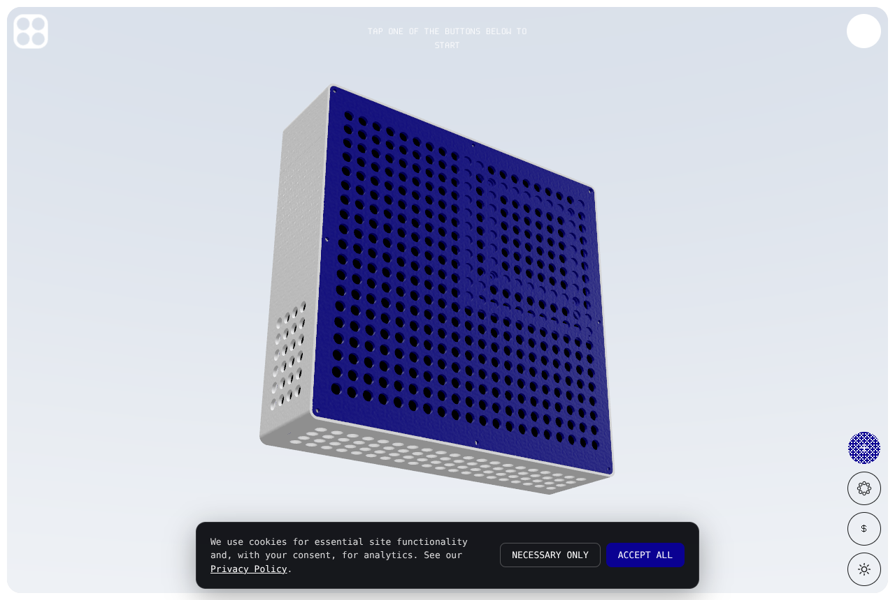
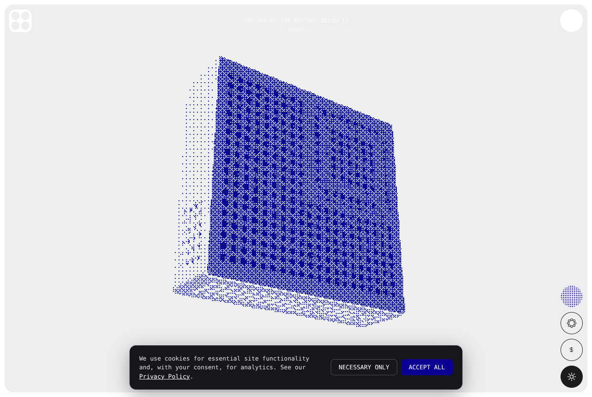
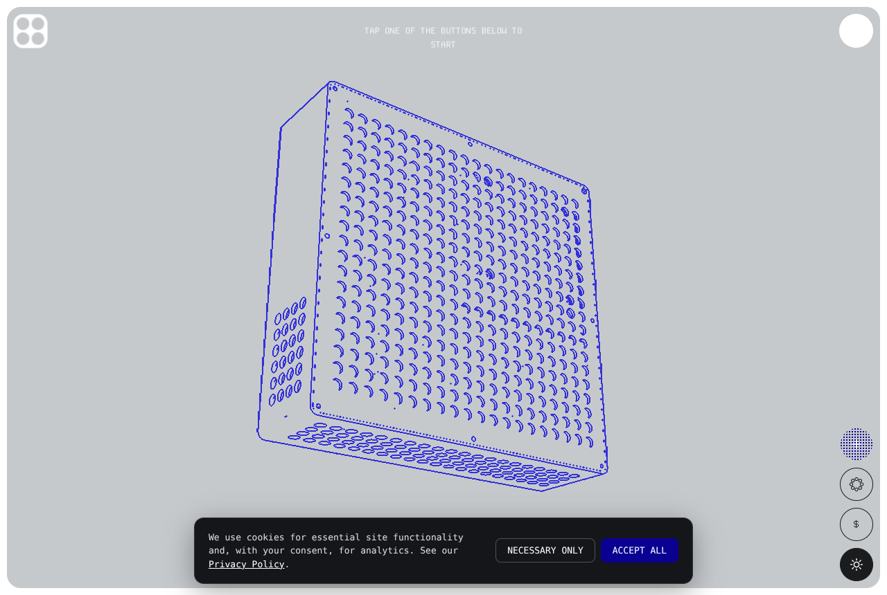

# Configurator: no print texture + Dithered and Wireframe environments

Patch for the 3D configurator code component on
`expansive-nectarine-220796.framer.app/configurator`. The component source lives in
Framer, so apply these edits in the Framer code editor. Each step names a string that
already exists in the component, so you can find the spot with Ctrl/Cmd+F.

Every change below was tested against the published build by patching its bundle and
rendering it in Chromium (see `screenshots/`).

| Before (Soft Studio) | Dithered | Wireframe |
| --- | --- | --- |
|  |  |  |

---

## 1. Remove the texture

The "texture" is the procedural 3D-print layer-line map (`printMap`) used as roughness
and bump on the standard case material.

**Find** the standard material factory (it uses `roughness: 0.78`):

```js
return new THREE.MeshStandardMaterial({
  color,
  roughness: 0.78,
  metalness: 0,
  roughnessMap: ctx.printMap ?? null,
  bumpMap: ctx.printMap ?? null,
  bumpScale: PRINT_BUMP_SCALE, // 0.9
})
```

**Replace with:**

```js
return new THREE.MeshStandardMaterial({
  color,
  roughness: 0.78,
  metalness: 0,
  roughnessMap: null, // print texture disabled for now
  bumpMap: null,
})
```

**And** in the function that (re)builds the part materials, delete the line that builds
the map so it isn't generated at all:

```js
ctx.printMap ||= makePrintTexture(THREE) // delete this line
```

Keep `makePrintTexture` itself so the texture is easy to bring back. The Milled Aluminum
(brushed metal) material is a separate map and is unchanged.

---

## 2. Add the two environments

**Find** the environments array (search for `` `case-colour` ``) and insert these two
entries just before the Case Colour entry. The new fields are `effect`, `ink`/`line`
and `paper`; the lighting fields are the same shape as the other presets.

```js
{
  id: "dithered",
  name: "Dithered",
  swatch: "#0a0192",
  effect: "dither",
  ink: 0x0a0192,     // dot colour (MYTY blue)
  paper: 0xeceef0,   // background / highlight colour
  background: 0xeceef0,
  sky: { top: 0xeceef0, bottom: 0xeceef0 },
  floor: { color: 0xeceef0, roughness: 0.9 },
  ambient: { color: 0xffffff, intensity: 0.55 },
  key: { color: 0xffffff, intensity: 2.6, position: [-3, 5, 3.5] },
  fill: { color: 0xffffff, intensity: 0.35, position: [4, 2, 2] },
  rim: { color: 0xffffff, intensity: 0.8, position: [0, 3, -5] },
},
{
  id: "wireframe",
  name: "Wireframe",
  swatch: "#c6c9cc",
  effect: "wireframe",
  line: 0x3230d8,    // line colour (blueprint blue from the reference)
  paper: 0xc6c9cc,   // background colour (reference grey)
  background: 0xc6c9cc,
  sky: { top: 0xc6c9cc, bottom: 0xc6c9cc },
  floor: { color: 0xc6c9cc, roughness: 0.9 },
  ambient: { color: 0xffffff, intensity: 0.95 },
  key: { color: 0xffffff, intensity: 1.9, position: [-2.5, 5, 3.5] },
  fill: { color: 0xeef0ff, intensity: 0.55, position: [4, 2, 2] },
  rim: { color: 0xffffff, intensity: 0.35, position: [0, 3, -5] },
},
```

The Lighting button already cycles through this array, so both show up with no UI
changes.

---

## 3. Post-process shader: add the two modes

Both looks run in the existing full-screen "film" pass (the `ShaderMaterial` that has
`uGrain` and `uCA`).

**3a. Uniforms.** Find `uCA: { value: ... }` in that material's `uniforms` and add the
new uniforms after it. `pixelRatio` is the `renderer.getPixelRatio()` value already used
for `uRes`.

```js
uCA: { value: CHROMATIC_ABERRATION },
uMode: { value: 0 },                      // 0 normal, 1 dither, 2 wireframe
uInk: { value: new THREE.Color(0x000000) },
uPaper: { value: new THREE.Color(0xffffff) },
tWire: { value: null },
uDitherPx: { value: 2 * pixelRatio },     // dither cell size in device pixels
uLinePx: { value: Math.max(1, pixelRatio) },
```

**3b. Declarations + helpers.** Find the first fragment line:

```
uniform sampler2D tScene; uniform float uTime; uniform vec2 uRes; uniform float uGrain; uniform float uCA; varying vec2 vUv;
```

and add these lines right after it in the `fragmentShader` array:

```js
`uniform float uMode; uniform vec3 uInk; uniform vec3 uPaper; uniform sampler2D tWire; uniform float uDitherPx; uniform float uLinePx;`,
`float bayer2(vec2 a){ a = floor(a); return fract(a.x / 2.0 + a.y * a.y * 0.75); }`,
`float bayer8(vec2 a){ return (bayer2(0.25 * a) * 0.25 + bayer2(0.5 * a)) * 0.25 + bayer2(a); }`,
`float wireEdge(vec4 c, vec4 n){ bool co = c.a > 0.0; bool no = n.a > 0.0; if (co != no) return 1.0; if (!co) return 0.0;`,
`  float dn = 1.0 - dot(normalize(c.xyz), normalize(n.xyz)); float dz = abs(c.a - n.a) / max(c.a, 1e-3);`,
`  return max(smoothstep(0.08, 0.2, dn), smoothstep(0.012, 0.03, dz)); }`,
```

**3c. Mode branches.** Directly after `` `void main(){` `` (before
`` `  vec2 c = vUv - 0.5;` ``) insert:

```js
`  if (uMode > 1.5) {`,
`    vec2 px = uLinePx / uRes; vec4 c0 = texture2D(tWire, vUv); float e = 0.0;`,
`    e = max(e, wireEdge(c0, texture2D(tWire, vUv + vec2(px.x, 0.0))));`,
`    e = max(e, wireEdge(c0, texture2D(tWire, vUv - vec2(px.x, 0.0))));`,
`    e = max(e, wireEdge(c0, texture2D(tWire, vUv + vec2(0.0, px.y))));`,
`    e = max(e, wireEdge(c0, texture2D(tWire, vUv - vec2(0.0, px.y))));`,
`    gl_FragColor = vec4(mix(uPaper, uInk, e), 1.0);`,
`    #include <colorspace_fragment>`,
`    return;`,
`  }`,
`  if (uMode > 0.5) {`,
`    vec2 cell = floor(vUv * uRes / uDitherPx);`,
`    vec3 s = texture2D(tScene, (cell + 0.5) * uDitherPx / uRes).rgb;`,
`    float l = pow(clamp(dot(s, vec3(0.2126, 0.7152, 0.0722)), 0.0, 1.0), 1.0 / 2.2);`,
`    l = clamp((pow(l, 0.62) - 0.5) * 1.3 + 0.52, 0.0, 1.0);`,
`    gl_FragColor = vec4(l > bayer8(cell) ? uPaper : uInk, 1.0);`,
`    #include <colorspace_fragment>`,
`    return;`,
`  }`,
```

How they work:

- **Dither:** the frame is snapped to a grid of cells. Each cell's brightness is compared
  against an 8×8 Bayer matrix and painted as `ink` or `paper`. The `pow(l, 0.62)` lift
  keeps the dark blue panel from going solid, so the vent holes still read. Make
  `uDitherPx` bigger for chunkier dots.
- **Wireframe:** instead of the lit scene, a separate pass stores each pixel's
  view-space normal and depth (step 4). A line is drawn wherever the normal or depth
  jumps between neighbouring pixels. That gives silhouettes, creases and hole rims, with
  hidden lines removed, like an exploded-view technical drawing.

---

## 4. Draw loop: render the normal/depth pass in wireframe mode

**Find** the per-frame draw function (it does
`renderer.setRenderTarget(filmTarget); renderer.render(scene, camera); renderer.setRenderTarget(null); renderer.render(postScene, postCamera)`)
and replace the scene render with:

```js
if (ctx.effect === "wireframe") {
  if (!ctx.wireTarget) {
    ctx.wireTarget = new THREE.WebGLRenderTarget(filmTarget.width, filmTarget.height, {
      type: THREE.HalfFloatType, // float so negative normals + real depth survive
    })
    ctx.wireMat = new THREE.ShaderMaterial({
      side: THREE.DoubleSide,
      vertexShader: `varying vec3 vN; varying float vZ;
        void main(){ vN = normalize(normalMatrix * normal);
          vec4 mv = modelViewMatrix * vec4(position, 1.0); vZ = -mv.z;
          gl_Position = projectionMatrix * mv; }`,
      fragmentShader: `varying vec3 vN; varying float vZ;
        void main(){ gl_FragColor = vec4(normalize(vN) * (gl_FrontFacing ? 1.0 : -1.0), vZ); }`,
    })
    filmMat.uniforms.tWire.value = ctx.wireTarget.texture
  }
  if (ctx.wireTarget.width !== filmTarget.width || ctx.wireTarget.height !== filmTarget.height)
    ctx.wireTarget.setSize(filmTarget.width, filmTarget.height)

  const skyVis = sky.visible, floorVis = floor.visible, bg = scene.background
  const clear = renderer.getClearColor(new THREE.Color()), clearA = renderer.getClearAlpha()
  sky.visible = false
  floor.visible = false
  scene.background = null
  scene.overrideMaterial = ctx.wireMat
  renderer.setClearColor(0x000000, 0) // alpha 0 = empty background
  renderer.setRenderTarget(ctx.wireTarget)
  renderer.clear()
  renderer.render(scene, camera)
  scene.overrideMaterial = null
  scene.background = bg
  sky.visible = skyVis
  floor.visible = floorVis
  renderer.setClearColor(clear, clearA)
} else {
  renderer.setRenderTarget(filmTarget)
  renderer.render(scene, camera)
}
renderer.setRenderTarget(null)
renderer.render(postScene, postCamera)
```

The pass uses `overrideMaterial`, so it follows every placed part, spawn animation and
the screen-holder swivel without touching the per-part materials.

---

## 5. Hook the environment into the render state

Add this helper next to the material functions:

```js
function applyEnvironmentEffect(ctx, env) {
  if (!ctx?.filmMat) return
  const { THREE } = ctx
  const u = ctx.filmMat.uniforms
  const effect = env.effect ?? "none"
  ctx.effect = effect
  u.uMode.value = effect === "dither" ? 1 : effect === "wireframe" ? 2 : 0
  u.uInk.value.set(new THREE.Color(env.line ?? env.ink ?? 0x000000))
  u.uPaper.value.set(new THREE.Color(env.paper ?? env.background))
}
```

Call it in two places:

1. **On mount:** right after `ctx.drawFrame = draw` (where `filmTarget`/`filmMat` are
   stored on the context): `applyEnvironmentEffect(ctx, env)`.
2. **On environment change:** in the effect that starts with
   `const shader = env.shader ?? "standard"` and lerps the lights, add
   `applyEnvironmentEffect(ctx, env)` after the `currentShader` check.

**Cleanup:** in the unmount disposal block, next to `filmMat?.dispose()`, add
`ctx.wireTarget?.dispose(); ctx.wireMat?.dispose();`.

---

## Notes

- The effect switches instantly while the lights still cross-fade over 900 ms. That
  looks fine because both new looks are flat, two-colour styles.
- The white "Tap one of the buttons…" hint is hard to read on light environments. This
  was already true for Soft Studio.
- To tweak the wireframe: raise `uLinePx` for thicker lines. Lower the `0.08 / 0.2`
  normal thresholds in `wireEdge` to draw more crease lines on curved surfaces, or raise
  them for fewer.
